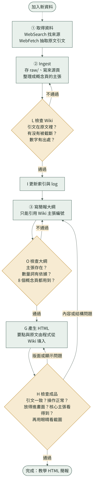

# Loop / Graph 設計、執行紀錄與反思

## 1. 流程圖



文字版：

```
① 取得資料 → ② Ingest（存 raw、寫來源頁、整理成概念頁主張）
   → L 檢查 Wiki ──不通過──→ 回 ② 
   → I 更新索引與 log
   → ③ 寫簡報大綱（只能引用 Wiki 主張編號）
   → O 檢查大綱 ──不通過──→ 回 ③
   → G 產生 HTML（要點與原文由程式從 Wiki 填入）
   → H 檢查成品（自動檢查 ＋ 看截圖）
        ├ 版面或顯示問題 → 回 G
        ├ 內容或結構問題 → 回 ③
        └ 通過 → 完成
加入新資料 → 回 ①
```

一次跑完所有檢查：`python tools/run_pipeline.py`。任何一關失敗會停下來，並說明要回到哪個節點。

## 2. 資訊怎麼被取得、整理、檢查、再產生成簡報

| 節點 | 做什麼 | 產出 | 檢查什麼 |
|---|---|---|---|
| ① 取得資料 | 用 WebSearch 找來源，用 WebFetch 抽取原文句子 | `raw/S1…S6.md`（原樣保存，附網址與抓取日期） | 來源要有出處；工具的概述不是原文，要標出來 |
| ② Ingest | 每篇寫一個來源頁；把內容整理成概念頁，每個主張固定四欄：ID、陳述（中文）、來源、引文（英文原句） | `wiki/sources/`、`wiki/concepts/` | 見節點 L |
| L 檢查 Wiki | `tools/lint_wiki.py` | 通過／錯誤清單 | 引文是否真的在該來源的原文裡；引文有沒有被截斷（含 `...`）；陳述裡的數字原文有沒有；ID 不重複；至少 5 篇來源；每個來源有沒有被用到 |
| I 更新索引 | `tools/build_index.py` | `wiki/index.md`、`wiki/log.md` | 索引由程式產生，不手改 |
| ③ 寫簡報大綱 | 在 `slides/slides.json` 決定每頁要放哪些主張 | 11 頁大綱 | 見節點 O |
| O 檢查大綱 | `tools/check_slides.py --outline` | 通過／錯誤清單 | 引用的主張存在；內容頁一定綁了主張；導讀文字裡的數量詞要有依據；8 個概念頁都有出現在簡報裡 |
| G 產生 HTML | `tools/build_slides.py` | `slides/index.html` | 要點與「原文」都由程式從 Wiki 讀出，不是手打 |
| H 檢查成品 | `tools/check_slides.py`（用瀏覽器實際開啟）＋看截圖 | 通過／錯誤清單 | 頁數一致；引文與 Wiki 逐字相同；鍵盤操作；1280×720 每頁放得進畫面；390px 手機寬度不橫向溢出；沒有外部資源（字型除外）；核心主張都直接看得到 |

簡報裡有三種文字，在畫面上刻意分開：

1. **要點**：Wiki 的「陳述」，標註來源編號（S1…S6）。
2. **原文**：點「原文」展開，是 Wiki 的英文原句。
3. **白話補充**：我的話，畫面上標明「不是來源」。

## 3. 哪些步驟會重複？哪裡要檢查、重新生成？為什麼這樣設計？

- **會重複的有三個小迴圈**：L ↔ ②（引文對不上就回去改）、O ↔ ③（大綱對不上 Wiki 就回去改）、H ↔ G/③（成品有問題就回去改）。每個迴圈都是「檢查失敗 → 回到產生那一關」，不會一路帶著錯誤往後走。
- **檢查放在每一次「換形式」的地方**：原文 → 中文陳述（L）、陳述 → 簡報大綱（O）、大綱 → 網頁（H）。每換一次形式就最容易走樣，所以每次都有一道檢查。
- **能用程式檢查的就不靠 AI 自己覺得對**：引文是否在原文、數字有沒有出處、頁面放不放得下，都是程式判斷。AI 讀過一遍會覺得沒問題的東西，程式常常抓得出來（見下面的紀錄）。
- **要點和原文由程式填入，不讓 AI 在最後一步重寫**：這樣簡報的內容不可能和 Wiki 不一致，H 只要確認「畫面上的字」和「Wiki 的字」一樣。
- **為什麼要以 Wiki 當中介，不直接從網頁產生簡報**：想追問「這句話哪裡來的」，可以從簡報頁面底部的編號找到 Wiki 的主張，再找到 raw 裡的原文。

## 4. 一次實際執行的紀錄（2026-11-25）

以下都是這次實際發生的結果。

**取得資料。** 6 篇來源：S1 Anthropic、S2 Lilian Weng、S3 OpenAI 指南、S4 ReAct 論文摘要、S5 Google Research ReAct 部落格、S6 Google Cloud。抽取工具的行為造成三個狀況：

- 每句最多回傳約 125 字元，所以 S4 只拿到每句的開頭（以 `...` 結尾）。
- S2、S5 的回覆中混入了工具「用自己的話」的概述，不是原文。
- S2 兩次抽取中，同一句話的撇號一次是 `’`、一次是 `'`。

這些都存進 raw/ 並在檔頭註明。lint 因此規定：引文含 `...` 就算錯誤；工具概述之後的文字不能當引文來源；比對前先統一引號。

**節點 L（檢查 Wiki）。** 第一次跑：3 個錯誤。

| 錯誤 | 判斷 | 處理 |
|---|---|---|
| COMP-3、COMP-4：陳述有「元件二」「元件三」，引文裡沒有 2、3 | 檢查太嚴：這是序數，不是數量 | 把陳述改成「第二個元件」「第三個元件」，lint 改成忽略序數 |
| WA-3：陳述寫「這兩類」，原文只說 "all these variations" | **真的錯誤**：數量是我自己加的 | 改成「這些不同的做法」 |

第二次跑：通過，6 篇來源、53 個主張。另有 2 個警告：workflow-patterns、workflow-vs-agent 兩頁只有 S1 一個來源，沒有交叉驗證。這是真實限制：五種 workflow 模式只有 Anthropic 這篇有。

**節點 O（檢查大綱）。** 第一次跑：s04 兩個錯誤。

- 導讀文字寫「三個能力」，但這頁有 4 張卡片（規劃、短期記憶、長期記憶、工具）。改成直接列出「規劃、記憶、工具使用」。
- 白話補充寫「兩種拆法不衝突」，「兩種」沒有依據。我重讀時另外發現同一句還寫了「記憶、規劃可以看成是指令與模型的延伸」，這是我自己的推論，沒有任何來源這樣說，也一併刪掉。

第二次跑：通過。

**節點 G / H（產生與檢查成品）。** 第一次檢查全部通過。接著我看截圖，發現「運作迴圈」那頁的核心依據（ReAct 那句）只出現在折起來的「補充主張」裡，使用者看不到。自動檢查沒有擋住這個問題（因為主張都存在、也都渲染了）。處理：

1. 把該頁改成直接顯示每個步驟的依據。
2. 重跑 H，這次抓到 s05 在 1280×720 放不下（超出 86px）。改成兩欄排列後通過。
3. 在 H 新增「核心主張必須直接看得到」的自動檢查。

另外，大綱裡有一個錯字「把把」是我讀文字時發現的，沒有任何檢查能抓到錯字（沒有拼字檢查節點）。

**最終結果。** `python tools/run_pipeline.py`：L、I、O、G、H 全部通過。11 頁簡報、6 篇來源、53 個主張。

**故意改壞的測試（確認檢查真的會擋）。** 在複製的專案上做，全部被擋下：

| 測試 | 結果 |
|---|---|
| 把引文改一個字（accomplish → finish） | L 報錯：引文沒有出現在 S3 的原文裡 |
| 陳述加入原文沒有的「90%」 | L 報錯：陳述出現數字 90，但引文裡沒有 |
| 簡報引用不存在的主張 AGENT-99；導讀文字寫「提高 40% 的效率」 | O 報兩個錯誤 |
| 把 LOOP-1 藏進折疊區 | H 報錯：核心主張沒有直接顯示 |

## 5. 反思

**哪個節點最常出錯？** 「寫簡報大綱（導讀文字）」。這次它產生了 5 個需要修的問題：「三個能力」、「兩種拆法」、一句沒有來源的推論、核心主張被藏起來、一個錯字。原因是這個節點是唯一一個由我自由寫字的地方：要點和原文是從 Wiki 帶進來的，只有 lead、白話補充、標籤是自己寫的，所以錯誤集中在這裡。「取得資料」節點雖然也有狀況（截斷、混入概述、引號不一致），但因為 L 擋在 ② 後面，都沒有流到後面的節點。

**我把檢查往前移到哪個步驟？**

- 「引文要完整、逐字」：原本很容易拖到最後才發現簡報引用的句子是被截斷的，所以放到 L，在整理概念頁的當下就擋掉。
- 「數字要有出處」：同時放在 L（陳述）和 O（導讀文字），不等成品做出來才看。
- 「核心主張要看得到」：這個一開始只靠我看截圖才發現，所以變成 H 的自動檢查，不再靠人眼。

**有沒有修改 workflow / graph？為什麼？** 有三處。

1. H 之後多一個固定動作「看截圖」：這次自動檢查全過，但畫面上有看得見的問題，所以自動檢查不能取代看一眼。
2. H 失敗的去向分成兩種：版面、顯示問題回 G；內容、結構問題回 ③。這次的「核心主張被藏起來」雖然最後改的是產生器，但本質是大綱結構問題，放回 ③ 才合理。
3. lint 的數字規則加上「序數不算數量」，因為第一版規則誤擋了兩個正常的陳述；檢查太嚴會讓人想繞過它，所以要調整。

## 6. 這個流程做不到的事（誠實說明）

- raw/ 存的是「工具抽出的逐字引文集」，不是整頁網頁備份。引文能保證在這些文字裡，但沒有辦法證明整頁網頁裡沒有其他和它矛盾的句子。
- 「中文陳述是否忠實翻譯英文引文」只能靠人讀，程式只檢查了數字。建議你抽讀幾個主張。
- 沒有拼字／錯字檢查。
- 5 種 workflow 模式與 workflow-vs-agent 只有 Anthropic 一個來源，沒有交叉驗證。
- 「先討論」的部分：這次只討論了主題、簡報對象與長度（log.md 有記錄）。你如果有自己對每篇來源的看法，請補在各 `wiki/sources/S*.md` 和 log.md。
